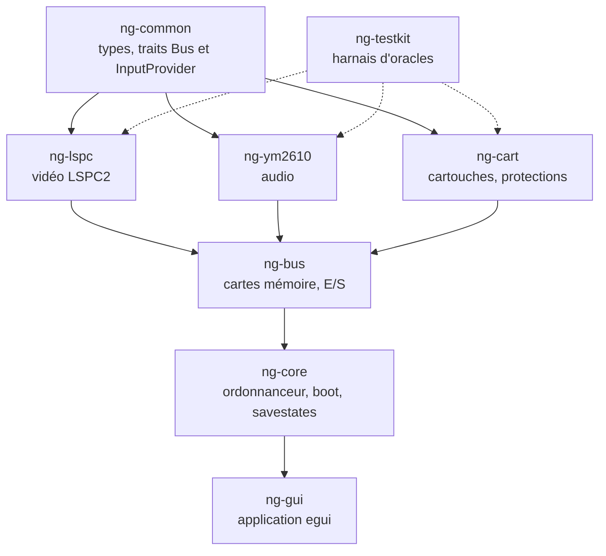

<div align="center">

# Puce16 Neo Geo

**Émulateur SNK Neo Geo (MVS et AES) précis au cycle près, écrit en Rust.**


*Cœur d'émulation déterministe · interface egui · rendu pixel perfect · filtres CRT · débogueur intégré*

</div>

---

## Sommaire

1. [Points forts](#points-forts)
2. [Installation](#installation)
3. [Configuration](#configuration)
4. [Utilisation](#utilisation)
5. [Compatibilité](#compatibilité)
6. [Architecture technique](#architecture-technique)
7. [Précision et performances](#précision-et-performances)
8. [Tests et outils](#tests-et-outils)
9. [Documentation](#documentation)
10. [Mentions légales et crédits](#mentions-légales-et-crédits)

## Points forts

- **Précision au cycle** : le 68000 est maître et avance une horloge à la fois ; à chaque accès au bus, le Z80 (au T-state près), le YM2610, le LSPC, la RTC et le chien de garde sont rattrapés. Les wait states de la cartouche et du BIOS sont émulés.
- **MVS et AES** : les deux modèles, avec le choix du BIOS depuis le menu.
- **Vidéo LSPC2** : sprites, fix layer, palette, auto-animation, timer et interruptions de trame, dans un écran visible de 320×224.
- **Audio YM2610** : FM, SSG, ADPCM-A et ADPCM-B, adaptés de ymfm, avec le Z80 de la carte son.
- **Protections de cartouches** : chiffrements CMC42/CMC50, PCM2, puces SMA, PVC, PRO-CT0 (Fatal Fury 2, Super Sidekicks), kof98, `sbp`, RAM de cartouche (V-Liner, Jockey GP).
- **Contrôleurs spéciaux** : panneau mahjong, trackball (The Irritating Maze) et molette (Pop'n Bounce), en plus des joysticks.
- **Affichage pixel perfect** : facteur entier, image centrée sur un pixel physique, plein écran (F11), ratio carré ou 4:3.
- **Filtres vidéo** : interpolation horizontale, scanlines standard ou adaptatives, gamma, masques d'écran (Sony Trinitron, Faded Tube), à partir des tables de la communauté MiSTer.
- **DIP switches MVS** et menu de service du BIOS accessibles depuis l'interface.
- **Débogueur** : CPU, mémoire (RAM 68000, RAM Z80, palette, VRAM), vidéo, palette et sprites.
- **Réglages sauvegardés** : touches, manettes, affichage, filtres et DIP dans `gui.toml`.

## Installation

### Prérequis

- [Rust](https://rustup.rs) (canal *stable*, configuré par `rust-toolchain.toml` avec `rustfmt` et `clippy`).
- Un système avec une sortie audio (cpal) et, en option, une manette (gilrs).
- Développé et testé sous **Windows**. Les dépendances (egui, cpal, gilrs) sont multiplateformes, mais seul Windows est testé.

### Compilation et lancement

```bash
git clone https://github.com/Farquaad56/Puce16_NeoGeo.git
cd Puce16_NeoGeo
cargo run --release -p ng-gui
```

Pour lancer directement un jeu avec un fichier de configuration précis :

```bash
cargo run --release -p ng-gui -- neogeo.toml mslug
```

Le premier argument est le fichier de configuration (par défaut `./neogeo.toml`), le second le nom du jeu (le nom du zip, sans l'extension). **Utilisez toujours `--release`** : le profil debug est trop lent pour le temps réel.

### Ce que vous devez fournir

Le dépôt ne contient **aucun BIOS ni aucune ROM commerciale**. Il vous faut :

| Élément | Où | Remarque |
|---|---|---|
| BIOS Neo Geo | `neogeo.zip` dans `bios_dir` | Jeu de fichiers au format MAME (`sp-s2.sp1`, etc.). |
| Jeux | `<nom>.zip` dans `roms_dir` | ROM sets au format MAME 0.287, par exemple `mslug.zip`. |

Au premier lancement, sans `neogeo.toml`, un formulaire demande les trois dossiers.

## Configuration

Copiez `neogeo.example.toml` en `neogeo.toml` et adaptez les chemins :

```toml
[paths]
bios_dir  = "D:/Emulation/Neogeo/roms"   # contient neogeo.zip
roms_dir  = "D:/Emulation/Neogeo/roms"   # contient mslug.zip, kof98.zip, ...
saves_dir = "saves"                      # sauvegardes et captures

[system]
model  = "mvs"          # "mvs" (arcade) ou "aes" (console)
bios   = "sp-s2.sp1"    # fichier BIOS pris dans neogeo.zip
```

Le modèle et le BIOS se changent aussi depuis le menu **Système**. Les préférences de l'interface (touches, affichage, filtres, DIP) sont écrites automatiquement dans `gui.toml`, à côté de `neogeo.toml`. Ces deux fichiers sont ignorés par git.

## Utilisation

### Menus

| Menu | Contenu |
|---|---|
| **Fichier** | Ouvrir (liste des jeux trouvés dans `roms_dir`, triés par titre), capture d'écran, quitter. |
| **Émulation** | Pause, reset, arrêter / démarrer l'émulation, configuration des contrôles. |
| **Audio** | Volume (0 à 100 %) et muet. |
| **Système** | DIP switches MVS, choix du BIOS, modèle MVS ou AES. |
| **Vidéo** | Échelle (auto ou x1 à x8), plein écran, ratio, lissage, overlay de performance, filtres vidéo. |
| **Débogage** | Débogueur, onglets, avance d'une trame, barre d'état. |

### Raccourcis et contrôles par défaut

| Touche | Action |
|---|---|
| Flèches · `Z` `X` `A` `S` | Joueur 1 : direction · boutons A B C D |
| `I` `J` `K` `L` · `G` `H` `T` `Y` | Joueur 2 : direction · boutons A B C D |
| `Entrée` · `P` | Start joueur 1 · Start joueur 2 |
| `Maj` · `Tab` | Select joueur 1 · Select joueur 2 |
| `5` · `6` | Pièces 1 et 2 |
| `9` · `F2` | Service · Test (menu de service du BIOS) |
| `F1` | Fenêtre des contrôles (réassignation clavier et manette) |
| `F3` · `F4` · `F7` | Volume − · volume + · muet |
| `F5` · `F6` | Pause · avance d'une trame |
| `F8` | Arrêter / démarrer l'émulation (redémarrage à froid du dernier jeu) |
| `F9` | Capture d'écran (`saves/shots/`) |
| `F10` | Overlay de performance |
| `F11` · `Échap` | Plein écran · quitter le plein écran |
| `F12` | Débogueur |

Les manettes sont reconnues automatiquement. Chaque touche et chaque bouton se réassigne dans **Contrôles** et la configuration est conservée. En plein écran, la barre de menus apparaît quand la souris touche le haut de l'écran.

### Jeux mahjong, trackball et molette

L'interface détecte le type de contrôleur du jeu : le panneau mahjong s'active pour `bakatono`, `janshin` et `minasan`, la souris pilote le trackball d'`irrmaze` et la molette de `popbounc` (curseur de sensibilité dans **Contrôles**).

### Filtres vidéo

**Vidéo → Filtres vidéo…** ouvre la fenêtre des filtres. Ils sont calculés à la taille finale de l'image et désactivés par défaut.

| Réglage | Options |
|---|---|
| Agrandissement pixel art | Aucun, HQ2X, 2xPM, Eagle, Super Eagle, SuperScale, SuperScale75, 2xSAI, Super 2xSaI, Scale2x |
| Préréglage d'écran | Aucun, Sony Trinitron, Faded Tube |
| Interpolation | Aucune, Douce, Moyenne, Nette, ou netteté de 5 à 100 % |
| Scanlines | Désactivées, Standard (0 à 95 %), Adaptatives (luminosité conservée selon la clarté du pixel) |
| Gamma | 1,00 à 2,00 |
| Masque | Aucun, Sony Trinitron, Tube fané (jaune), avec une force réglable |

Les coefficients proviennent des fichiers de filtres et de masques de la communauté MiSTer, regroupés dans `crates/ng-gui/data/fx.bin` par `tools/gen_fx_data.py`. L'agrandissement pixel art double la définition (640x448) avant les autres filtres ; Scale2x, Eagle, Super Eagle, 2xSaI, Super 2xSaI et HQ2X suivent les implémentations de référence (RetroArch / libretro, table HQ2X dans `data/hq2x_lut.bin` générée par `tools/gen_hq2x_lut.py`). 2xPM et SuperScale sont des plugins de Kega Fusion sans code public : leurs versions sont des approximations (marquées « approx. »). Les scanlines se voient à partir d'une échelle x2 et les masques à partir d'une hauteur d'image suffisante.

### Overlay de performance

`F10` (ou **Vidéo → Overlay de performance**) affiche une barre en surimpression, désactivée par défaut. En mode compact : FPS et temps d'émulation par trame. En mode détaillé : courbe des 120 dernières trames (ligne grise = budget de 16,9 ms, rouge au-dessus), min et max, vitesse par rapport au temps réel, durée d'une image de l'interface, coût des filtres vidéo, remplissage du tampon audio, échelle d'affichage. Les valeurs sont colorées selon leur état : vert (bon), orange (limite), rouge (problème). Pour l'audio, le rouge signale un craquement dans les 3 dernières secondes. Le coin d'affichage et le niveau de détail se règlent dans **Vidéo → Overlay**. La barre d'état affiche aussi le temps moyen par trame.

### DIP switches MVS

**Système → DIP switches MVS…** : mode test, nombre de monnayeurs, type de contrôleur, liaison, Free Play et Freeze. Le réglage est appliqué à chaud et conservé.

## Compatibilité

Le catalogue compte **169 jeux** (liste complète dans [`docs/CATALOGUE.md`](docs/CATALOGUE.md), générée par `tools/gen_catalogue_md.py`). Chaque jeu est démarré par un banc automatique et comparé à des captures de référence de MAME 0.287.

| Banc | Résultat |
|---|---|
| 600 trames, 169 jeux | 53 conformes, 9 en écart, 107 « noirs » (BIOS encore à l'écran), 0 échec |
| Relance à 1500 trames des « noirs » et d'un échantillon | 155 jeux conformes au total, 10 en écart, 4 « noirs » qui tournent en réalité (peu de couleurs) |

Les écarts connus (démarrage en retard sur quelques jeux KOF, dérives à long terme sur `mslug3`, `garou`, `fatfury3`, `rbff2`, écran de `jockeygp`) sont décrits dans [`docs/QUESTIONS.md`](docs/QUESTIONS.md). Onze jeux (homebrews et conversions) ne sont pas définis par MAME 0.287 et n'ont donc pas de comparaison.

## Architecture technique

### Horloge et cadencement

Tout est exprimé en ticks de l'horloge maître **24 MHz** :

| Composant | Fréquence |
|---|---|
| 68000 | maître ÷ 2 = 12 MHz |
| Z80 | maître ÷ 6 = 4 MHz |
| YM2610 | maître ÷ 3 = 8 MHz |
| Pixel LSPC | maître ÷ 4 = 6 MHz |
| Trame | 384×264 pixels, 405 504 mclk, ≈ 59,19 Hz |

### Organisation du code



| Crate | Rôle |
|---|---|
| `ng-common` | Types de base (cycles), traits `Bus`, `Component`, `InputProvider` (interfaces figées). |
| `ng-lspc` | Vidéo : LSPC2, palette, fix layer, sprites. |
| `ng-ym2610` | Audio : FM, SSG, ADPCM-A/B, mixage (adapté de ymfm). |
| `ng-cart` | Catalogue de 169 jeux, chargement des zips, déchiffrements, banking, BIOS. |
| `ng-bus` | Cartes mémoire 68000 et Z80, E/S, backup RAM, latch son, ports de protection. |
| `ng-core` | Ordonnanceur, wait states, démarrage, états de sauvegarde, instantanés de débogage. |
| `ng-testkit` | Comparaison aux oracles (images et PCM) et outil en ligne de commande. |
| `ng-gui` | Interface egui/eframe, audio cpal, manettes gilrs, filtres vidéo. |

Les CPU sont deux crates du même auteur, épinglées par révision git : [`puce-m68k`](https://github.com/Farquaad56/CPU-Motorola_68K_Crates_Rust) (Motorola 68000, au cycle près) et [`puce-z80`](https://github.com/Farquaad56/CPU-Zilog-Z80_Crates_Rust) (Zilog Z80).

### Ordonnanceur

Le 68000 avance **une horloge à la fois**. À chaque accès bus, un rattrapage (*catch-up*) fait avancer les autres composants jusqu'à l'instant courant. Un mode paresseux évite ces rattrapages tant qu'aucune échéance (chien de garde, timer) n'est proche : les résultats restent identiques octet par octet (vérifié par savestate et CRC de trames) et le coût baisse d'environ 22 %.

### Interface

Le cœur ne connaît ni egui ni les threads. `ng-gui` lance l'émulation dans un thread dédié, échange par canaux (commandes, trames, instantanés de débogage) et pilote l'audio par un tampon circulaire. Les filtres vidéo sont calculés sur plusieurs threads à partir de la trame 320×224 finie, ce qui ne modifie en rien l'émulation.

## Précision et performances

Mesures en profil release, sur la machine de développement :

| Mesure | Résultat |
|---|---|
| Cœur d'émulation (mslug3, kof2003, kof98, samsho5, garou, mslugx) | 4,1 à 4,5 ms par trame, soit environ 4 fois le temps réel (budget : 16,9 ms) |
| Filtres vidéo (x1 à x8, 1:1 et 4:3, plein écran 720p à 4K, tous filtres) | 0,3 à 7,6 ms par trame |

Les bancs sont relançables :

```bash
cargo test --release -p ng-core --test speed -- --ignored --nocapture   # noyau
cargo test --release -p ng-gui bench_fx -- --ignored --nocapture        # filtres
cargo bench -p ng-core --bench frame                                    # criterion
```

## Tests et outils

```bash
cargo test --workspace                 # tests unitaires et d'intégration
cargo clippy --workspace --all-targets -- -D warnings
cargo fmt --all -- --check
```

Les tests qui ont besoin du BIOS ou de ROM sont marqués `#[ignore]` et ne tournent que si vos fichiers locaux sont présents :

```bash
# Banc du catalogue (NG_GAMES, NG_FRAMES, NG_BIOS, NG_STRICT, NG_DUMP)
cargo test --release -p ng-core --test catalogue -- --ignored --nocapture
```

| Outil | Rôle |
|---|---|
| `scripts/gate.ps1` | Barrière de qualité : format, clippy, tests, métriques qui ne peuvent pas baisser (`metrics/`). |
| `tools/gen_tables.py`, `tools/catalogue.py` | Génèrent les définitions des jeux et des protections. |
| `tools/gen_catalogue_md.py` | Génère `docs/CATALOGUE.md` à partir du banc. |
| `tools/mame_golden_batch.ps1` | Produit des captures de référence avec MAME (local uniquement). |
| `tools/gen_fx_data.py` | Génère les tables de filtres vidéo. |

Les captures de référence, ROM et BIOS restent en local (`tests-data/`, `roms/`) et ne sont jamais versionnés.

## Documentation

| Document | Contenu |
|---|---|
| [`docs/ARCHITECTURE.md`](docs/ARCHITECTURE.md) | Horloges, ordonnanceur, organisation du workspace |
| [`docs/spec/`](docs/spec) | Spécifications matérielles : horloge, carte mémoire, LSPC, audio Z80, protections, boot et E/S |
| [`docs/PERF.md`](docs/PERF.md) | Mesures et optimisations |
| [`docs/TESTING.md`](docs/TESTING.md) | Oracles et règles de test |
| [`docs/CATALOGUE.md`](docs/CATALOGUE.md) | État de chacun des 169 jeux |
| [`docs/QUESTIONS.md`](docs/QUESTIONS.md) | Écarts connus et pistes |
| [`docs/STATE.md`](docs/STATE.md) | Journal d'avancement |
| [`docs/METHOD.md`](docs/METHOD.md) | Méthode de développement agentique |

Le projet a été construit avec une méthode de développement agentique : des cartes de tâches (`tasks/`) avec commandes d'acceptation chiffrées, un journal d'état et une barrière de qualité. Voir [`docs/METHOD.md`](docs/METHOD.md) et [`AGENTS.md`](AGENTS.md).

## Mentions légales et crédits

- **Aucun BIOS ni aucune ROM commerciale n'est fourni, ni versionné.** Utilisez uniquement des dumps de jeux que vous possédez légalement.
- Neo Geo, MVS et AES sont des marques de SNK. Ce projet n'est affilié à aucun ayant droit.
- Le cœur audio YM2610 est adapté de **ymfm** par Aaron Giles (licence BSD 3 clauses).
- Les captures de référence et la documentation du comportement du matériel s'appuient sur **MAME** et sur la documentation de la communauté Neo Geo (NeoGeo Development Wiki).
- Les tables de filtres et de masques d'écran proviennent de la communauté **MiSTer** (dépôts `Filters_MiSTer` et `ShadowMasks_MiSTer`) ; les préréglages Sony Trinitron et Faded Tube sont de TrashUncle.
- Interface : [egui / eframe](https://github.com/emilk/egui), [cpal](https://github.com/RustAudio/cpal), [gilrs](https://gitlab.com/gilrs-project/gilrs).
- Licence du code : MIT (voir `Cargo.toml`).

Projet de la famille **Puce16** (émulateurs Rust cycle-exact : NES, Game Boy, SNES, Neo Geo).
